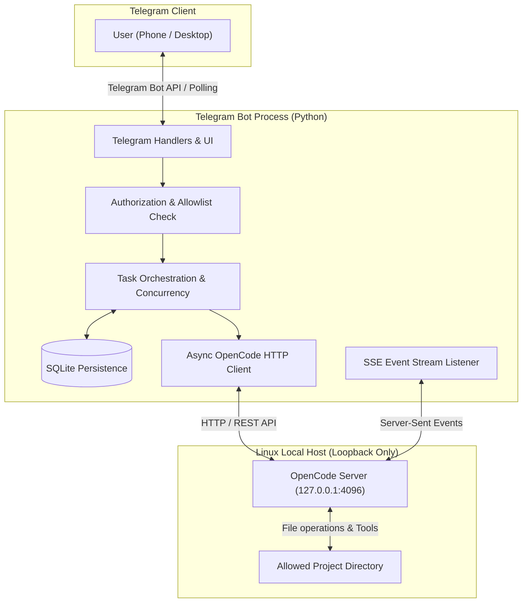

# OpenCode Telegram Remote Controller — Implementation Walkthrough

This document provides a comprehensive, step-by-step implementation guide for building a secure, local-first Telegram bot that remotely controls an OpenCode server instance on a Linux host.

---

## 1. System Overview & Architecture

The OpenCode Telegram Remote Controller acts as a bridge between your mobile/desktop Telegram client and a local OpenCode server running in headless mode (`opencode serve`).

### Architecture Diagram



### Core Design Principles
1. **API-First (Headless Server)**: Interacts strictly with OpenCode's documented HTTP/SSE endpoints. Avoids brittle screen scraping or terminal parsing.
2. **Defense-In-Depth Security**: Bound strictly to `127.0.0.1`. Strict Telegram user ID allowlist and path traversal protection for project directories.
3. **Non-Blocking & Asynchronous**: Built with Python `asyncio`, keeping Telegram update polling responsive while background AI tasks execute.
4. **Durable State Management**: Persistent SQLite storage ensures active project choices, session contexts, and running tasks survive bot restarts.

---

## 2. Prerequisites & Setup

### Requirements
- Linux OS (with `systemd --user` support)
- Python 3.10+
- Installed `opencode` CLI tool
- A Telegram account and Bot Token from [@BotFather](https://t.me/BotFather)

### Environment Configuration

Create a `.env` file in the project directory:

```env
TELEGRAM_BOT_TOKEN="123456789:ABCdefGhIJKlmNoPQRsTUVwxyZ"
TELEGRAM_ALLOWED_USER_IDS="123456789,987654321"
OPENCODE_BASE_URL="http://127.0.0.1:4096"
DATABASE_PATH="./data/bot.sqlite3"
LOG_LEVEL="INFO"
```

Create a `config.toml` file for project allowlisting:

```toml
[server]
base_url = "http://127.0.0.1:4096"
connect_timeout_seconds = 5
request_timeout_seconds = 600

[projects]
default = "opencode-bot"

[projects.opencode-bot]
path = "/home/aditys/code/opencode_extension/opencode-bot"

[bot]
max_active_tasks_per_session = 1
progress_update_interval_seconds = 10
max_telegram_message_length = 4000
```

---

## 3. Detailed Implementation Roadmap

### Phase 1: OpenCode API Integration Layer (`opencode/client.py`)

Build an asynchronous HTTP client wrapper using `httpx` to interface with the **OpenCode V2 API** at `http://127.0.0.1:4096`. V2 exposes its API under the `/api` prefix and requires authentication. When `OPENCODE_SERVER_PASSWORD` is set, the server uses HTTP basic auth (username defaults to `opencode`, override with `OPENCODE_SERVER_USERNAME`).

Key Endpoints to Wrap (V2):
- `GET /api/info`: Server info / health check.
- `POST /api/session`: Create a session (send `location: {directory}` to bind a project).
- `GET /api/session`: List sessions (`directory` query filters by project).
- `POST /api/session/{id}/prompt`: Enqueue a prompt (returns the accepted inbox item immediately).
- `POST /api/session/{id}/interrupt`: Interrupt the running turn.
- `GET /api/session/{id}/message`: Read conversation messages (`order=desc` for newest-first).
- `GET /api/session/{id}/diff`: Inspect file modifications.
- `GET /api/event`: Open the SSE stream for real-time events.

```python
# Example Client Structure snippet
import httpx

class OpenCodeClient:
    def __init__(self, base_url: str, password: str = "", username: str = "opencode"):
        auth = (username, password) if password else None
        self.client = httpx.AsyncClient(base_url=base_url, auth=auth, timeout=30.0)

    async def check_health(self) -> bool:
        resp = await self.client.get("/api/info")
        return resp.status_code == 200 and "version" in resp.json()

    async def create_session(self, title: str | None = None, directory: str | None = None) -> dict:
        payload: dict = {"title": title}
        if directory:
            payload["location"] = {"directory": directory}
        resp = await self.client.post("/api/session", json=payload)
        resp.raise_for_status()
        return resp.json()["data"]

    async def send_prompt(self, session_id: str, prompt: str) -> dict:
        resp = await self.client.post(f"/api/session/{session_id}/prompt", json={"text": prompt})
        resp.raise_for_status()
        return resp.json()["data"]
```

Note: the V2 prompt endpoint accepts the message and returns immediately. Completion is detected from the event stream (`session.idle` / `session.execution.succeeded|failed|interrupted`) with a polling fallback against `GET /api/session/{id}/message`; the messages API remains the source of truth. See `opencode/router.py` and `services/tasks.py`.

---

### Phase 2: Security & Authorization Engine (`bot/authorization.py`)

Every incoming update (commands, text messages, inline button callbacks) must pass authorization checks.

1. **User Allowlist Verification**: Reject updates where `user.id` is not in `TELEGRAM_ALLOWED_USER_IDS`.
2. **Project Path Validation**: Validate configured project paths using `pathlib.Path.resolve()` to prevent directory traversal attacks or symlink escapes.

```python
from pathlib import Path

def is_user_authorized(user_id: int, allowed_ids: set[int]) -> bool:
    return user_id in allowed_ids

def validate_project_path(requested_path: str, allowed_roots: list[Path]) -> Path:
    resolved = Path(requested_path).resolve()
    for root in allowed_roots:
        if root.resolve() in resolved.parents or resolved == root.resolve():
            return resolved
    raise ValueError("Access to path outside allowed directory is denied.")
```

---

### Phase 3: Persistence & Database Schema (`storage/database.py`)

Use SQLite to store user state, active project selections, active session mapping, and task states across bot restarts.

```sql
-- Schema Overview
CREATE TABLE IF NOT EXISTS user_states (
    telegram_user_id INTEGER PRIMARY KEY,
    selected_project TEXT,
    selected_session_id TEXT,
    updated_at TIMESTAMP DEFAULT CURRENT_TIMESTAMP
);

CREATE TABLE IF NOT EXISTS sessions (
    session_id TEXT PRIMARY KEY,
    project_name TEXT NOT NULL,
    telegram_user_id INTEGER,
    title TEXT,
    created_at TIMESTAMP DEFAULT CURRENT_TIMESTAMP
);

CREATE TABLE IF NOT EXISTS tasks (
    task_id TEXT PRIMARY KEY,
    session_id TEXT NOT NULL,
    telegram_user_id INTEGER NOT NULL,
    state TEXT CHECK(state IN ('queued', 'running', 'awaiting_permission', 'completed', 'failed', 'cancelled')),
    prompt TEXT,
    created_at TIMESTAMP DEFAULT CURRENT_TIMESTAMP,
    updated_at TIMESTAMP DEFAULT CURRENT_TIMESTAMP
);
```

---

### Phase 4: Telegram Interface & Command Handlers (`bot/handlers.py`)

Implement commands using `python-telegram-bot`:

| Command | Action |
|---|---|
| `/start` | Display welcome, authorization status, and quick command guide |
| `/projects` | List available allowlisted projects |
| `/project <name>` | Select active working project |
| `/new` | Spawn a new OpenCode session in active project |
| `/sessions` | List sessions in current project |
| `/session <id>` | Select active session |
| `/models` | View available LLMs & switch model for active session |
| `/agent <build\|plan>` | Switch agent mode (Build or Plan) |
| `/rename <title>` | Rename session title |
| `/ask <prompt>` | Submit coding task to active session |
| `/status` | View running task state, session status, and server health |
| `/stop` | Abort active task in current session |
| `/diff` | Show file modification summary |
| `/history` | Show session message history |

---

### Phase 5: Task Orchestration & Concurrency Control (`services/tasks.py`)

To prevent overlapping edits or race conditions:
1. Enforce a **single active prompt per session** using in-process `asyncio.Lock` paired with SQLite state locks.
2. Mark tasks `queued` -> `running` -> `completed` / `failed` / `cancelled`.
3. Support non-blocking operation: `/ask` returns immediately with a Task ID acknowledgement while the task executes asynchronously.

---

### Phase 6: Event Listener & Permission Workflow (`opencode/events.py`, `opencode/router.py`)

Connect to `GET /api/event` via HTTP SSE streaming to receive live updates. Frames are `data: {json}` lines where the JSON is `{"id", "type", "data"}`; ignore `:` heartbeat comments and reconnect with backoff. `opencode/router.py` is the single fan-out point: it dispatches every event to subscribers and lets `services/tasks.py` block on a specific session/type (`wait_for`).

1. **Event-Driven Completion**: `services/tasks.py` wakes on `session.idle` / `session.execution.succeeded|failed|interrupted` instead of only polling, then re-reads messages (the authoritative source) with `evaluate_completion`. A polling interval remains as a safety net.
2. **Live Progress**: tool/step events (`session.tool.input.started`, `session.step.started`) update the task's acknowledgement message, throttled by `progress_edit_interval_seconds`.
3. **Reactions**: `session.execution.*` drives 👀 / ✅ / ❌ / 🛑 reactions on the task message (`bot/notifier.py`).
4. **Interactive Permissions**: on `permission.asked`, send an inline **Approve** / **Deny** message whose `callback_data` is a short token (Telegram caps callbacks at 64 bytes); on click, post the resolution to the V2 `/permission/{id}/reply` endpoint and edit the message to reflect the outcome (including replies made elsewhere).
5. **Heartbeat**: `services/heartbeat.py` aggregates active sessions / approvals / cost and keeps one pinned status message per chat up to date.

---

### Phase 7: Linux `systemd` User Service Setup (`systemd/`)

Manage both OpenCode server and the Telegram bot as user services on Linux.

`~/.config/systemd/user/opencode-server.service`:
```ini
[Unit]
Description=OpenCode Headless Server
After=network.target

[Service]
Type=simple
WorkingDirectory=/home/aditys/code/opencode_extension/opencode-bot
ExecStart=/usr/local/bin/opencode serve --hostname 127.0.0.1 --port 4096
Restart=always
RestartSec=5

[Install]
WantedBy=default.target
```

`~/.config/systemd/user/opencode-telegram.service`:
```ini
[Unit]
Description=OpenCode Telegram Remote Control Bot
After=opencode-server.service

[Service]
Type=simple
WorkingDirectory=/home/aditys/code/opencode_extension/opencode-bot
ExecStart=/usr/bin/python3 -m opencode_telegram.main
Restart=always
RestartSec=5
EnvironmentFile=/home/aditys/code/opencode_extension/opencode-bot/.env

[Install]
WantedBy=default.target
```

Enable user lingering so services run without an active SSH session:
```bash
loginctl enable-linger aditys
systemctl --user daemon-reload
systemctl --user enable --now opencode-server.service
systemctl --user enable --now opencode-telegram.service
```

---

## 4. Testing & Verification Checklist

### Unit & Integration Testing
- [ ] Test authorization rejection for unauthorized Telegram user IDs.
- [ ] Test path validation against symlink escapes.
- [ ] Verify HTTP client error handling when OpenCode server is unreachable.
- [ ] Verify message length chunking logic for large outputs (>4000 characters).

### Manual Acceptance Flow
1. **Startup Check**: Run `curl http://127.0.0.1:4096/global/health`.
2. **Bot Initialization**: Send `/start` from Telegram. Ensure only allowed user ID gets access.
3. **Project & Session Setup**: Select project using `/project opencode-bot`, then create session using `/new`.
4. **Execute Coding Task**: Send `/ask Create a hello_world.py file with a main function`.
5. **Inspect Progress & Status**: Check `/status` while running, then review `/diff` when finished.
6. **Task Cancellation**: Trigger a long-running prompt and send `/stop` to verify graceful cancellation.
7. **Bot Recovery**: Restart bot process (`systemctl --user restart opencode-telegram`) and verify `/status` remembers active session.

---

## 5. Summary & Next Steps

1. Create Python package structure in `src/opencode_telegram/`.
2. Implement core modules sequentially according to Phase 1 through Phase 7.
3. Verify local OpenCode endpoints against `/doc`.
4. Deploy under systemd user services.
